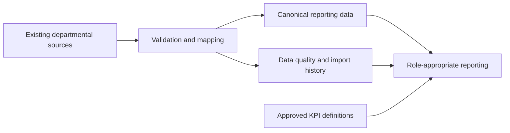

# Operations Intelligence Hub

**Enterprise operational analytics — an independent solution architecture and development case study**

Status: discovery documented; requirements and architectural proposals awaiting review. No application has been implemented or deployed.

## Business problem

A fictional growing professional-services organization relies on disconnected departmental systems and manual monthly reporting. Leadership needs timely, trustworthy operational metrics without disrupting existing business workflows or unnecessarily exposing sensitive information.

## Proposed approach

Preserve departmental source systems, standardize approved operational data, validate incoming information, expose data quality and freshness, and report performance against agreed departmental objectives.

This is a conceptual architecture, not a deployed system. Power Platform and Dataverse are candidates, not final selections. Licensing, connector support, identity options, reporting requirements and alternatives will be evaluated before implementation.

## Project documentation

- [Discovery findings](docs/DISCOVERY.md)
- [Requirements baseline](docs/REQUIREMENTS.md)
- [Proposed V1 scope](docs/SCOPE.md)
- [Acceptance criteria](docs/ACCEPTANCE_CRITERIA.md)
- [Architecture decision register](docs/adr/README.md)
- [Open questions and decision gates](docs/OPEN_QUESTIONS.md)
- [Governance alignment](docs/GOVERNANCE_ALIGNMENT.md)
- [Technical learning journal](docs/LEARNING_JOURNAL.md)

## Governance

This project references the companion [Enterprise M365 Governance Framework](https://github.com/iramos85/enterprise-m365-governance). Governance policies remain under development; alignment is proposed, not evidence of compliance.

## Development lifecycle

Discovery → requirements review → architecture evaluation → proof of concept → implementation → technical testing → simulated UAT → demonstration release.

Every significant decision should record alternatives, rationale, trade-offs and validation evidence. Requirements changes are evaluated against the agreed release scope. All data and stakeholders are fictional; no employer information, credentials or proprietary materials are used.

## Current milestone

Review discovery and agree the reporting definitions, source contracts and access boundaries. Evaluate licensing and technology options before selecting a pilot source and building the proof of concept.
